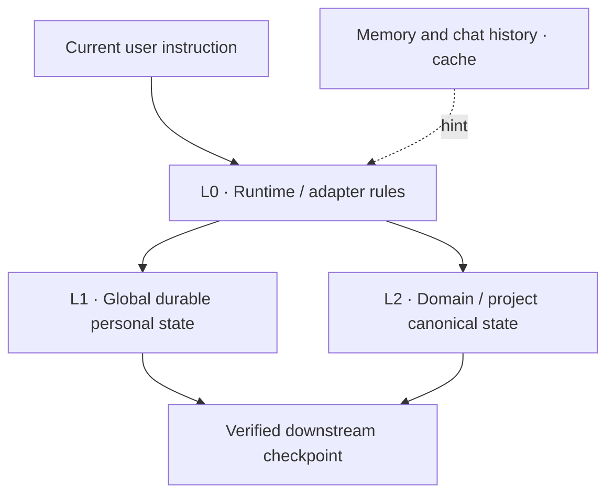

# src_you

> **Give your AI a clear rule for which personal or project record to trust when memories disagree.**

[](https://github.com/focaxisdev/src_you/actions/workflows/validate.yml)
[](LICENSE)

`src_you` is for developers connecting AI assistants to maintained personal or
project state. It provides rules, templates, and executable examples for choosing
the current record, preserving replaced values, and keeping project details out
of a global profile. You choose the private store and verify the adapter.

Start with the synthetic demo below. Nothing connects to an account or starts a
background service. This is an early reference implementation; adopting its
files alone does not make an agent follow the rules.

## Run the conflict demo

You need Git and **Python 3.10+**; there are no third-party Python dependencies,
API keys, or npm installation steps. Run these commands from a parent folder
where you want the checkout. After `cd`, all commands run inside `src_you`:

If needed, replace `python` in every command with `python3` (macOS/Linux) or
`py -3` (Windows). These commands also work in PowerShell. Check the reported
version before running the scripts. Cloning needs network access; the demo does not.

```bash
git clone https://github.com/focaxisdev/src_you.git
cd src_you
python --version
```

After confirming Python 3.10 or newer, run from the same checkout root:

```bash
python scripts/demo_memory_conflict.py
```

A fictional user changes focused meetings from afternoon to morning:

| Point in the demo | Maintained record | Cached Memory | Selected value |
|---|---|---|---|
| Before the prepared update | Afternoon | Afternoon | Not queried yet |
| After saving and reloading | Morning; afternoon retained as superseded | Afternoon | Morning |
| Deliberate invalid state | Two current records | Irrelevant | Rejected |

Expected output includes this excerpt:

```text
Canonical now:    Prefer focused meetings in the morning.
Cached Memory:    Prefer focused meetings in the afternoon. (unchanged; not authoritative)
Selected value:   Prefer focused meetings in the morning.
```

Later, the output ends with:

```text
Negative case (two current records): REJECTED: expected exactly one current canonical record.
Temporary state removed; repository inputs were not modified.
```

`REJECTED` is the expected negative case; the full demo exits successfully.
The update is hand-prepared, saved to temporary JSON, and read back. This shows a
state transition, not an AI before/after benchmark. It runs no model, repairs no
real cache, and changes no personal state.

Continue with the [walkthrough and full output](examples/memory-conflict-demo/README.md),
or follow the [quick start](docs/quick-start.md) to verify the repository and
optionally create an unfilled scaffold outside the checkout.

## src_you or Deja Vu?

**Use [Deja Vu](https://github.com/focaxisdev/deja-vu) to help a coding agent
find useful project memory. Use `src_you` to define what maintained personal
and project state means, who may update it, and which record wins a conflict.**

| Your question | Where to start |
|---|---|
| “Why did this repo choose this database? The next coding session needs that decision.” | Deja Vu's repo-local memory and selective recall |
| “An old memory says afternoon, but my maintained preference says morning. Which one governs, and where does project detail belong?” | `src_you`'s authority, update, and scope rules |

This describes their main focus, not every feature. Both have rules for
maintained state and small, relevant reads. Deja Vu offers file-based setup and
an optional npm CLI; `src_you` offers policy templates and Python reference checks.

They could complement each other: retain coding detail in Deja Vu and only a
project summary and pointer in private global state. **No ready-to-use integration
is included.** Combining them would require an explicit mapping of records,
ownership, and adapter behavior, followed by tests. See the
[sourced comparison](docs/related-work.md) for the scope and limits.

## Why this exists

Chat history preserves what was said. Product Memory recalls useful context.
Vector search finds similar material. A second brain accumulates knowledge.
None of those mechanisms alone establishes which value currently governs when:

- an old preference survives beside its replacement;
- a project next step is copied into a global profile and drifts;
- cached Memory conflicts with a maintained record;
- an inference is repeated until it looks like a fact;
- a newer backup is mistaken for the live source.

`src_you` treats this as **durable personal state governance**, not simply
storage or retrieval.

## What it is — and is not

The repository provides architecture, normative policies, operational prompts,
private-state templates, synthetic examples, reference adapters, acceptance
tests, and dependency-free validation tools.

It is not:

- a vector database, RAG server, chat archive, or prompt collection;
- an Obsidian replacement or a requirement to use Markdown;
- an AI clone, personality simulator, or “digital consciousness”;
- a hosted backend, sync service, or telemetry system;
- a reason to put personal data in GitHub.

The framework can be public. **Your actual personal state should be private,
user-controlled, and separate from this repository.**

## Architecture



| Layer | Owns | Must not own |
|---|---|---|
| **L0 — Runtime / adapter** | Routing, retrieval, priority, conflicts, platform mapping | Personal facts or project progress |
| **L1 — Global durable state** | Identity, durable preferences, goals, constraints, decisions, commitments, deadlines, major milestones, cross-project state, pointers | Exact next step, current question, code cell, or session handoff |
| **L2 — Domain / project state** | Specialized detailed progress, evidence, handoff, temporary blockers, and micro-state | A competing global profile |

The boundary is:

```text
PROJECT_DETAILED_STATE != GLOBAL_STATE
```

L1 may say a certification project is active, name its deadline and major phase,
and point to L2. L2 alone owns “question 17,” the temporary misconception, and
the exact next action. Changing question 17 to 18 should not require an L1 edit.

## The governance contract

1. **One canonical owner.** Every active state item has one authoritative owner
   for its scope.
2. **Memory is cache, not authority.** Memory and old chats may assist recall;
   they do not overrule maintained state.
3. **Update in place.** A durable change leaves one `current` value and marks
   the prior value `superseded` under a stable record ID.
4. **Keep L1 and L2 distinct.** Global state stores durable summaries and
   pointers; project micro-state stays local.
5. **Retrieve minimally.** Route first, then load only the scopes required for
   the task.
6. **Resolve conflicts by scope.** A current explicit instruction leads for the
   turn; the canonical owner for the relevant scope governs maintained state.
7. **Type claims.** Keep Fact, Decision, Preference, Inference, and Open Loop
   distinct. Never silently promote Inference to Fact.
8. **Revalidate external observations.** Prices, laws, jobs, product versions,
   public roles, and news are dated observations, not timeless personal facts.
9. **Keep recovery explicit.** Checkpoints and backups are downstream; a newer
   timestamp cannot appoint a new authority.
10. **Make privacy architectural.** Secrets and unnecessary raw sensitive
    evidence do not belong in durable core state.

Read [Architecture](docs/architecture.md), [Core concepts](docs/concepts.md),
the [Operational contract](docs/operational-contract.md), and the normative
[`policies/`](policies/) for the complete contract.

## From demo to your own setup

From the `src_you` checkout root, validate the public examples and tooling:

```bash
python scripts/run_checks.py
```

Expected final line: `All repository checks passed: 12 gates.` The gates include
105 unit tests. They verify the reference code, not your future agent integration.

The [quick start](docs/quick-start.md) explains scaffold preview, creation,
expected output, and safe refusal cases. If you already have a maintained store,
start with [the existing-system audit](prompts/audit-existing-system.md) before
creating another one. Keep real personal state outside this public repository.

After scaffolding, you still need to designate the authoritative store and
writer, configure a capable adapter, and test its behavior. No scheduled service
or automatic cross-platform synchronization is installed.

## Reference adapters

Adapters keep product behavior replaceable:

- [`adapters/chatgpt/`](adapters/chatgpt/) maps ChatGPT instructions, projects,
  files/sources, and Memory.
- [`adapters/codex/`](adapters/codex/) maps layered `AGENTS.md` guidance, local
  project files, authorized filesystem state, and local Codex Memory.

Both are capability-aware and dated. Product features can change; core
canonical-state semantics should not. Read the
[adapter contribution guide](adapters/README.md) before proposing another one.

## Privacy model

| Asset | Default visibility | Role |
|---|---|---|
| Framework repository | Public or private | Reusable rules, examples, and tooling |
| L1 canonical personal state | **Private** | Current global durable state |
| L2 canonical project state | Private or narrowly project-scoped | Detailed domain and project state |
| Checkpoints and history | **Private** | Recovery only |

Never store passwords, tokens, cookies, private keys, OTPs, full payment
credentials, or unnecessary raw confidential documents in core state. Prefer a
minimum durable summary and safe logical pointer. Read
[Privacy and security](docs/privacy-and-security.md) before using real data.

## Validation and conformance

Run every public-repository gate:

```bash
python scripts/run_checks.py
```

Or run the component commands listed in [CONTRIBUTING.md](CONTRIBUTING.md).
CI runs the same gates on Linux and Windows for every push and pull request.

Repository checks validate structure, strict UTF-8, internal links, high-signal
sensitive patterns, synthetic fixtures, safe scaffolding, and checkpoint
integrity. They also verify the public social-preview dimensions, checksums, and
absence of embedded text/EXIF metadata. They cannot prove that a private
implementation behaves correctly.
Implementation conformance requires evidence for all fourteen scenarios in
[`tests/acceptance-tests.md`](tests/acceptance-tests.md), including routing,
supersession, conflict resolution, privacy, recovery, Inference handling, and
platform portability.

Adapters providing unattended work should also use the
[execution reliability contract](docs/execution-reliability.md): verify entry
policy dependencies, classify failures before bounded recovery, and distinguish
schedule acceptance from each run's source access, save, backup, and notification.
The reference includes synthetic checks; it supplies no scheduler or persistent
job engine and does not certify future platform execution.

## Repository map

```text
docs/                 Architecture, quick start, roadmap, and design rationale
policies/             Normative retrieval, update, conflict, privacy, and recovery rules
prompts/              Bootstrap, audit, normalize, checkpoint, restore, and upgrade workflows
templates/src_you/    Private-state scaffold to copy into a controlled store
adapters/             Replaceable platform capability mappings
examples/             Synthetic demonstrations only
tests/                Behavioral acceptance contract and synthetic fixtures
scripts/              Small standard-library validation and bootstrap tools
```

## Status and roadmap

**Current release line: v0.3.x — early public reference implementation.**

Version 0.3.0 adds the [execution reliability contract](docs/execution-reliability.md):
entrypoint policy dependency checks, bounded opt-in safe-read retries, explicit
failure classification, and separate run-stage evidence. It preserves unresolved
write outcomes as BLOCKED and validates checkpoint metadata before inventory
verification. Twelve standard-library gates include 105 synthetic unit tests.

The [verified state operations](docs/operational-contract.md) introduced in 0.2.0
retain identity, version guards, exact readback, and concurrent-change protection.
There is no scheduler, durable job engine, or notification sender; synthetic
continuation tests do not establish real platform failure recovery.

The core L0/L1/L2 model and private-state layout are unchanged. No data migration
is required. These synthetic checks do not verify provider capabilities or LLM
behavior; adapters must demonstrate their actual guard and readback support.
See the [changelog](CHANGELOG.md) for compatibility and upgrade guidance.

The next milestone is not a larger feature surface. It is implementation
feedback: evidence that different private stores and AI platforms preserve the
same ownership, supersession, routing, privacy, and recovery semantics.

See the [Now / Next / Later / Research roadmap](docs/roadmap.md) and the
[implementation report guide](docs/implementation-reports.md).

## Contributing, security, and license

Contributions are welcome. Start with [CONTRIBUTING.md](CONTRIBUTING.md), keep
examples synthetic, and explain which invariant a change preserves. For a
suspected privacy leak or vulnerability, follow [SECURITY.md](SECURITY.md) and
do not put sensitive evidence in a public issue.

Maintainers should use the [release process](docs/release-process.md) before
creating or promoting a tag.

Licensed under the [MIT License](LICENSE).
